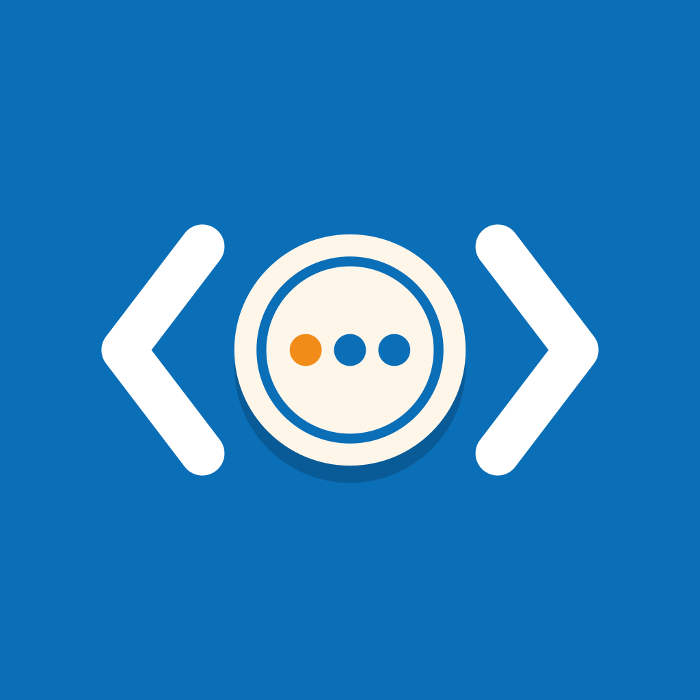
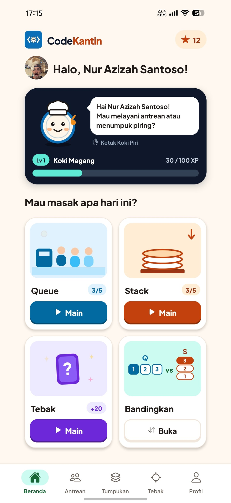
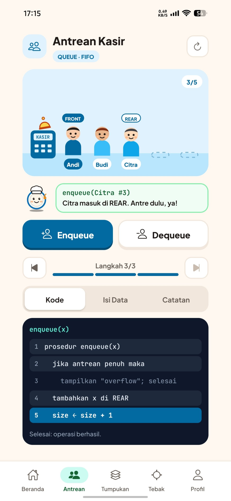
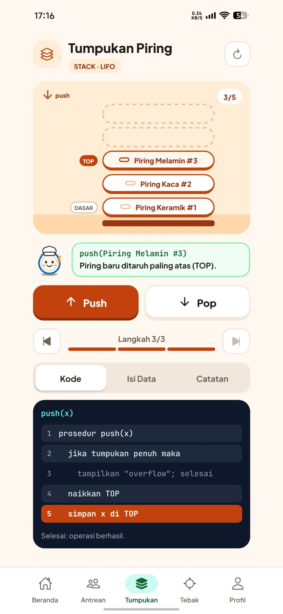
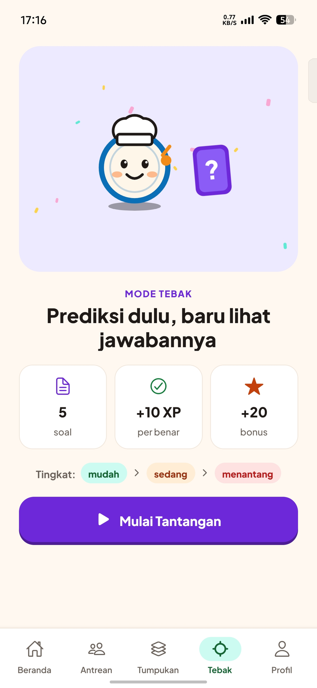
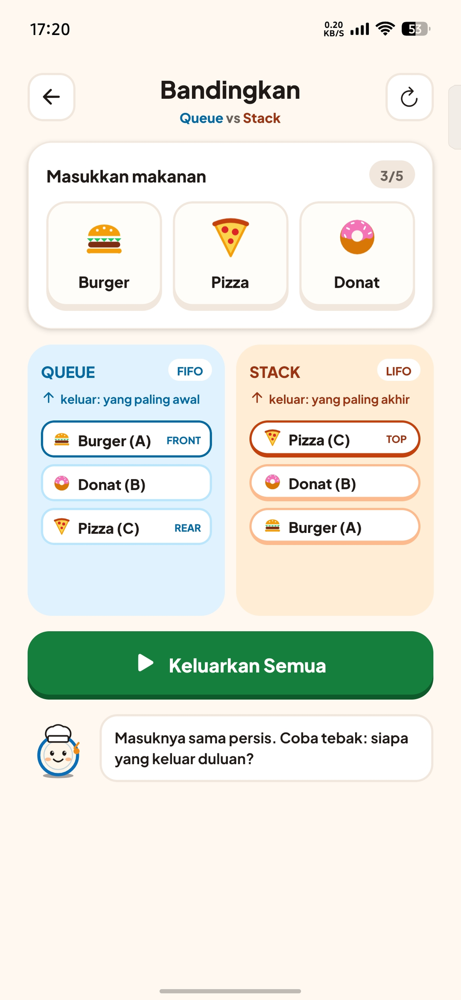
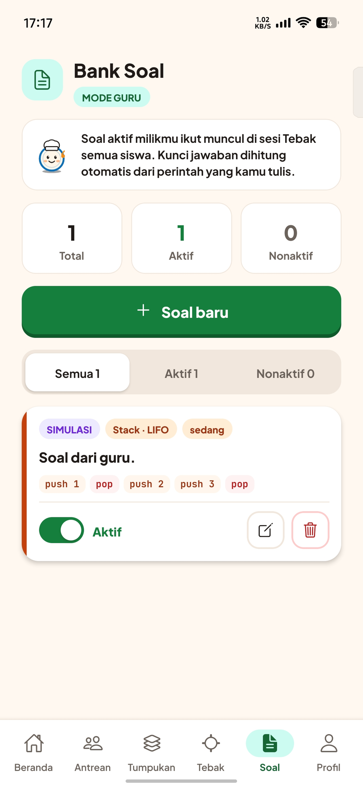

<p align="center">
  
</p>

<h1 align="center">CodeKantin</h1>

<p align="center">
  <b>Belajar Stack &amp; Queue lewat dapur restoran</b><br>
  Media belajar interaktif struktur data untuk siswa SMA, dibuat dengan React Native (Expo) dan Supabase.
</p>

<p align="center">
  <a href="https://github.com/nrzzhs/codekantin/releases/download/v1.0/K04_CodeKantin_v1.0.apk"><b>Unduh APK v1.0</b></a> ·
  <a href="#fitur">Fitur</a> ·
  <a href="#menjalankan-proyek">Menjalankan proyek</a> ·
  <a href="#riwayat-versi">Riwayat versi</a>
</p>

---

## Tentang

CodeKantin membantu siswa SMA kelas X–XII memahami **Queue (FIFO)** dan **Stack (LIFO)** lewat simulasi dapur restoran yang bisa dimainkan:

- **Queue** = antrean pelanggan di kasir: yang datang pertama dilayani pertama.
- **Stack** = tumpukan piring di rak: piring yang terakhir ditaruh diambil pertama.

Setiap operasi langsung terlihat sebagai animasi, disertai pseudocode yang menyala baris demi baris. Pemahaman diuji lewat Mode Tebak, dengan hadiah XP, poin, dan lencana. Guru Informatika dapat menambah soal sendiri ke bank soal yang langsung dipakai semua siswa.

Aplikasi ini adalah tugas besar mata kuliah **IK300 Mobile Programming**, Program Studi Pendidikan Ilmu Komputer, FPMIPA, Universitas Pendidikan Indonesia.

## Fitur

| Fitur | Keterangan |
|---|---|
| **Simulasi Antrean (Queue)** | Enqueue dan dequeue pelanggan (kapasitas 5), penanda FRONT/REAR, pesan overflow/underflow, putar ulang langkah, pseudocode yang menyala, dan panel isi data. |
| **Simulasi Tumpukan (Stack)** | Push dan pop piring dengan penanda TOP, dilengkapi fitur yang sama seperti simulasi Antrean. Progres simulasi tersimpan per akun. |
| **Mode Tebak** | 5 soal per sesi (prediksi urutan keluar dan pilihan ganda), tingkat mudah sampai menantang, penjelasan langkah demi langkah, diagnosis miskonsepsi, serta XP dan poin yang tersimpan ke server. Hasil yang gagal terkirim saat offline dikirim ulang otomatis. |
| **Bandingkan Stack vs Queue** | Makanan yang sama dimasukkan ke Queue dan Stack sekaligus untuk melihat perbedaan urutan keluarnya. |
| **Bank Soal (guru)** | Guru membuat, mengubah, menonaktifkan, dan menghapus soal. Kunci jawaban dihitung otomatis dari perintah. |
| **Akun dan profil** | Daftar, masuk, lupa password, nama panggilan, biodata, dan foto profil. |
| **Gamifikasi** | Lencana Koki Magang (0 XP), Koki Muda (100), Koki Handal (300), dan Master Koki LIFO/FIFO (600), serta maskot Koki Piri. |

Aksesibilitas: kontras teks minimal 4,5:1 (diuji otomatis), target sentuh minimal 44 px, label pembaca layar, dan animasi yang berhenti saat pengaturan "hapus animasi" di HP aktif.

## Tangkapan Layar

| Beranda | Antrean | Tumpukan |
|---|---|---|
|  |  |  |

| Mode Tebak | Bandingkan | Bank Soal |
|---|---|---|
|  |  |  |

## Unduh dan Pasang

1. Unduh **[K04_CodeKantin_v1.0.apk](https://github.com/nrzzhs/codekantin/releases/download/v1.0/K04_CodeKantin_v1.0.apk)** (93,7 MB) dari halaman [Releases](https://github.com/nrzzhs/codekantin/releases).
2. Buka berkasnya di HP Android, izinkan **Instal aplikasi tak dikenal** bila diminta, lalu ketuk **Instal**.

Persyaratan: Android 7.0 atau lebih baru, ruang kosong sekitar 250 MB, dan koneksi internet untuk login serta menyimpan XP.

**Akun demo (peran guru):** `guru123@gmail.com` / `guru123`. Mohon tidak menghapus soal contoh.

## Teknologi

| Bagian | Teknologi |
|---|---|
| Aplikasi | React Native, Expo SDK 58, React 19, TypeScript |
| Navigasi | React Navigation 7 (bottom tabs dan native stack) |
| Animasi dan grafis | React Native Reanimated, react-native-svg, @expo/vector-icons (Ionicons) |
| Tipografi | expo-font, Plus Jakarta Sans, JetBrains Mono |
| Umpan balik sentuhan | expo-haptics |
| Backend | Supabase: Auth (email dan password), PostgreSQL, Storage (foto profil), fungsi database untuk XP dan poin |
| Penyimpanan lokal | AsyncStorage (progres simulasi) |
| Pengujian | Jest (jest-expo), TypeScript, ESLint |
| Build | EAS Build |

Daftar lengkap dependency beserta versinya ada di [`package.json`](package.json).

## Struktur Folder

```
├── App.tsx            # alur aplikasi: cek sesi → login → nama panggilan → aplikasi utama
├── screens/           # layar: Login, Beranda, Antrean, Tumpukan, Tebak, Bandingkan, Profil, Kelola Soal, Form Soal
├── components/        # komponen bersama (ui/, ilustrasi/, simulasi/, Loading, PanelPseudocode, KartuModul)
├── logic/             # logika Stack, Queue, kunci jawaban, dan pemeta miskonsepsi
├── data/              # teks materi, soal bawaan, dan fakta "Tahukah Kamu?"
├── hooks/  context/   # state simulasi dan bank soal
├── lib/               # tema (warna, font, jarak) dan klien Supabase
├── assets/            # ikon, splash, dan gambar
└── __tests__/         # tes logika dan tes kontras warna
```

## Menjalankan Proyek

### Prasyarat
- Node.js versi LTS dan npm
- Akun [Expo](https://expo.dev) dan EAS CLI: `npm install -g eas-cli`
- HP Android (atau emulator)
- Proyek Supabase dengan URL dan *anon key*

### Langkah
```bash
git clone https://github.com/nrzzhs/codekantin.git
cd codekantin
npm install
```

Buat file `.env` di folder utama (file ini **tidak** ikut di-commit):
```env
EXPO_PUBLIC_SUPABASE_URL=https://xxxxx.supabase.co
EXPO_PUBLIC_SUPABASE_ANON_KEY=isi-anon-key
```

> Gunakan hanya *anon key*. Jangan pernah memasukkan `service_role` key ke aplikasi atau repo.

CodeKantin memakai **development build** (bukan Expo Go):
```bash
eas build --profile development --platform android   # sekali saja, lalu pasang APK-nya di HP
npx expo start --dev-client                          # jalankan server, lalu buka aplikasi di HP
```

### Pengujian
```bash
npm test             # tes logika dan tes kontras warna
npx tsc --noEmit     # pemeriksaan tipe TypeScript
npx expo lint        # pemeriksaan gaya kode
```

### Membuat APK rilis
Variabel lingkungan untuk build di server EAS diisi sekali:
```bash
eas env:create --environment preview --name EXPO_PUBLIC_SUPABASE_URL --value "..." --visibility plaintext
eas env:create --environment preview --name EXPO_PUBLIC_SUPABASE_ANON_KEY --value "..." --visibility sensitive
```
Lalu build:
```bash
eas build --profile preview --platform android
```
Profil `preview` di `eas.json` menghasilkan berkas `.apk` yang bisa langsung dipasang. Sebelum build rilis berikutnya, naikkan `android.versionCode` di `app.json`.

## Riwayat Versi

| Versi | Tanggal | Perubahan |
|---|---|---|
| **1.0.0** | 24 November 2026 | Rilis pertama: simulasi Antrean dan Tumpukan, Mode Tebak dengan XP, poin, dan lencana, Bandingkan Stack vs Queue, Bank Soal untuk guru, profil, serta tampilan baru (logo, splash, maskot Koki Piri, font, ikon, dan animasi). |

Catatan rilis lengkap ada di halaman [Releases](https://github.com/nrzzhs/codekantin/releases).

## Tim Pengembang

**Kelompok 4, Pendidikan Ilmu Komputer 5A, Universitas Pendidikan Indonesia**

| Nama | Peran |
|---|---|
| Belva Risma Aydina | [peran] |
| Muhammad Baihaqi Bashair | [peran] |
| Nur Azizah Santoso | [peran] |
| Raisyah Alika Salam | [peran] |

Dosen pengampu: **Erlangga, S.Kom., M.T.**

---

<p align="center">Dibuat untuk tugas besar IK300 Mobile Programming, 2026.</p>
